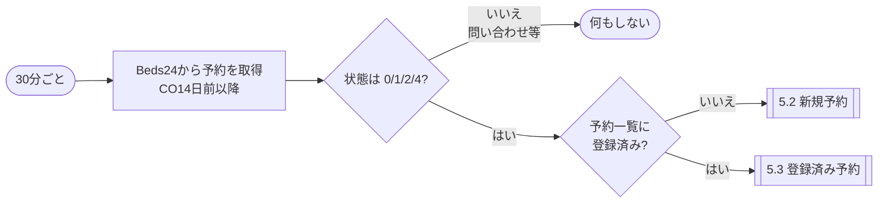
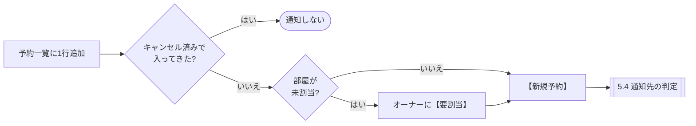
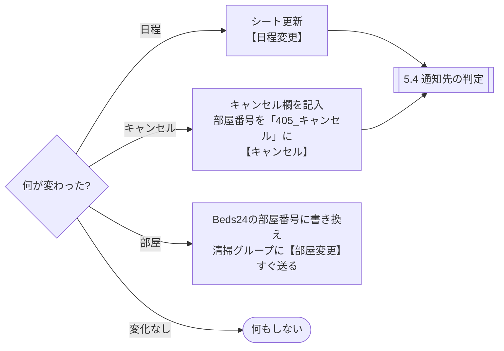
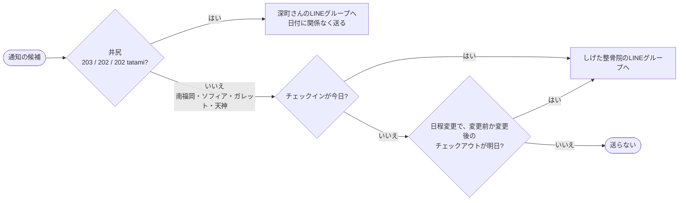

# minpaku-reservation-notifier 要件定義書

民泊の予約を Beds24 から予約一覧スプレッドシートへ自動で反映し、清掃の連絡を LINE で自動化する Google Apps Script（GAS）の要件定義。

- 「何を・なぜ」実現するかはこのファイル、「どう動くか（実装）」は [SPEC.md](SPEC.md) に書く
- GAS プロジェクト: 「[民泊]宿泊施設予約一覧まとめ」（ichika4561@gmail.com）
- 最終更新: 2026-11-15

---

## 1. 目的

| # | 目的 | 効果 |
|---|------|------|
| 1 | 全物件の予約を1枚のスプレッドシートに自動で集める | オーナー・外注さん・清掃会社が同じ情報を見られる。手入力の手間と転記ミスをなくす |
| 2 | 清掃が必要な予約を清掃会社へ自動で連絡する | 清掃手配の連絡漏れをなくし、オーナーの手配作業をなくす |
| 3 | 予約ごとの部屋番号を正しく記録する | 清掃する部屋の間違いと、チェックイン案内の部屋違いを防ぐ |
| 4 | 宿泊税申告・宿泊実績報告の元データを残す | 施設番号・人数・国籍などを月次・2か月ごとの届出に使える |

## 2. 背景

- 物件は5施設・8部屋タイプ（Beds24 の Room ID 単位）。予約は Booking.com・Airbnb から入り、Beds24（サイトコントローラー）に集まる
  - 井尻202号室は、Beds24 上で「202 tatami」（662306）と「202」（662309）の2つの部屋タイプとして販売している（中身は同じ1部屋。Beds24 の連動設定で片方が埋まるともう片方も閉じる）
- 2026-11-15 から、Airbnb の**予約前の問い合わせ・予約リクエスト**も Beds24 に取り込んでいる（ゲスト返信アシスタントで問い合わせに気づくため）。これらは確定した予約ではないため、このシステムでは扱わない（FR-05）
- 予約の確認と清掃会社への連絡を手作業で行うと、時間がかかり漏れも出る
- 予約一覧スプレッドシートは外注さんも直接見て操作する、運営の共通台帳になっている

## 3. 関係者

| 関係者 | 関わり方 |
|--------|----------|
| オーナー | システムの管理者。部屋が決まらない予約の割り当てなど、例外対応を行う |
| 外注さん | 予約一覧スプレッドシートを見て、ゲスト対応などに使う |
| 清掃会社（井尻） | 深町さんの LINE グループで、井尻の予約の連絡を受ける |
| 清掃連絡先（井尻以外） | しげた整骨院の LINE グループで、南福岡など井尻以外の物件の連絡を受ける（2026-11 時点。変わったらコードの `LINE_GROUP_SHIGETA` と本書を更新） |
| チェックイン案内の自動送信（別システム） | スプレッドシートの部屋番号と Beds24 の部屋を照合し、一致した予約だけに案内を送る（[minpaku-checkin-sender](https://github.com/ichika4561/minpaku-checkin-sender)） |

## 4. 対象範囲

### 対象
- 管理物件全部（南福岡ルネッサンス／ソフィアたかき(貝塚)／コーポプチミラージュ(井尻)／ガレット空港前／ポートハウス天神）の予約
- 予約一覧スプレッドシートの「予約リスト(自動更新)」シートへの追加・更新
- 清掃グループ・オーナーへの LINE 通知

### 対象外
- ゲストへのメッセージ送信（チェックイン案内は別システム）
- 予約の受付・料金・在庫（空き部屋）の管理（Beds24・各予約サイトの役割）
- 部屋の割り当てそのもの（Beds24 で行う。このシステムは結果を記録するだけ）
- チェックアウトから14日以上たった予約の変更・キャンセルの反映
- 予約確定前の Airbnb 問い合わせ・予約リクエスト（予約一覧への追加・清掃通知とも行わない）

## 5. 処理の流れ（フロー図）

### 5.1 全体の流れ（30分ごと）



状態 0=キャンセル・1=確定・2=新規・4=ブロック。問い合わせ・リクエストは、確定すると次の回で新規予約として扱われる。

### 5.2 新規予約



### 5.3 登録済み予約



### 5.4 通知先の判定（新規予約・日程変更・キャンセル）



- 【部屋変更】は上の判定を通さず、その物件の清掃グループ（井尻=深町さん、それ以外=しげた整骨院）に、日付に関係なくすぐ送る
- 【要割当】はオーナー個人（DevBot）にだけ送る。清掃グループには送らない

## 6. 機能要件

### 6.1 予約の取り込み
| ID | 要件 |
|----|------|
| FR-01 | 30分ごとに Beds24 から全物件の予約を取得する |
| FR-05 | 予約の状態が「キャンセル（0）・確定（1）・新規（2）・ブロック（4）」以外の予約（Airbnb の予約前の問い合わせ・予約リクエストなど）は、予約一覧に追加せず、どの通知も送らない。予約が確定して状態が変わった時点で、新規予約として追加・通知する（2026-11-15） |
| FR-02 | 予約一覧に未登録の予約は、1行追加する（予約ID・ゲスト名・チェックイン/アウト・施設番号・施設名・部屋番号・予約サイト・大人/子供/合計人数・国籍・キャンセル・キャンセル時刻） |
| FR-03 | 登録済みの予約でチェックイン/アウト日が変わったら、スプレッドシートを更新する |
| FR-04 | 予約がキャンセルされたら、キャンセル欄・キャンセル時刻を埋め、部屋番号を「405_キャンセル」のような形にする（行は削除しない） |

### 6.2 部屋番号
| ID | 要件 |
|----|------|
| FR-10 | 部屋番号は **Beds24 の部屋の割り当てをそのまま使う**（部屋の決定権は Beds24 にある） |
| FR-11 | 1部屋しかない部屋タイプは、その部屋番号を記録する |
| FR-12 | 複数の部屋がある部屋タイプ（南福岡 405/605）で、Beds24 でも部屋が決まっていない予約は、部屋番号を「**要割当**」にする |
| FR-13 | Beds24 で部屋が移された・決まった場合は、スプレッドシートの部屋番号も Beds24 に合わせて書き換える |
| FR-14 | Beds24 で部屋が未割当に戻っても、スプレッドシートに入っている部屋番号は消さない |
| FR-15 | キャンセル済みの予約は、部屋番号を書き換えない |

### 6.3 LINE 通知
| ID | 通知 | 送り先 | 条件 |
|----|------|--------|------|
| FR-20 | 新規予約 | 井尻: 深町さんグループ／井尻以外: しげた整骨院グループ | 井尻は常に。井尻以外はチェックインが当日の予約のみ。キャンセル済みで入ってきた予約は送らない |
| FR-21 | 日程変更 | 同上 | 井尻は常に。井尻以外は、チェックインが当日、または変更前後のチェックアウトが翌日の予約 |
| FR-22 | キャンセル | 同上 | 井尻は常に。井尻以外はチェックインが当日の予約のみ |
| FR-23 | 【部屋変更】部屋番号が変わった | 同上 | 日付に関係なく、変わったらすぐ |
| FR-24 | 【要割当】部屋が決まっていない予約がある | **オーナー個人**（DevBot） | 「要割当」になったときに1回 |

- 清掃グループには、清掃に関係する内容だけを送る。オーナーが対応する内容（要割当）は清掃グループに送らない
- 【部屋変更】の文面（オーナー指定）:
  ```
  【部屋変更】部屋番号が変わりました
  宿泊施設名：【南福岡ルネッサンス】
  ・チェックイン：2026-11-24
  ・チェックアウト：2026-11-30
  ・部屋番号：405 → 605
  ・ゲスト名：Wu Wenqi
  ・ゲスト人数：1
  ```

## 7. 非機能要件

| 項目 | 要件 |
|------|------|
| 反映の速さ | 予約・変更は最大30分程度でスプレッドシートに反映されればよい |
| 実行時間 | GAS の1回の実行時間上限（6分）に収める。取得範囲を「チェックアウトが14日前以降」に絞り、スプレッドシートの読み込みは1回にまとめる |
| 障害時 | Beds24 API の一時的なエラーで1回失敗しても、次の実行（30分後）で回復すればよい |
| 秘密情報 | API キー・LINE トークンはコードに書かず、GAS のスクリプトプロパティで管理する（GitHub に残さない） |
| 個人情報 | ゲスト名・人数・国籍は、関係する清掃グループとオーナーにだけ送る |
| 変更管理 | ソースは GitHub で管理し、git commit → clasp push で反映する。GAS エディタで直接編集しない |

## 8. 運用ルール

1. **部屋の変更は必ず Beds24 で行う。** スプレッドシートで部屋番号を直しても、Beds24 と違えば30分以内に Beds24 の値に戻り、清掃グループに【部屋変更】が届く
2. **【要割当】が届いたら、オーナーが Beds24 で部屋を割り当てる。** 全泊を通して空いている部屋がない場合は、まだ案内を送っていない別の予約を移して空きを作る
3. **案内を送ったあとに部屋を移した場合は、ゲストへの再連絡をオーナーが手動で行う**（部屋番号・キーボックス番号が変わるため）
4. 外注さんにも「部屋の変更は Beds24 で」を共有する

## 9. 前提・制約

- Booking.com・Airbnb は「その夜に何部屋空いているか」で予約を受けるため、途中で部屋を移らないと泊まれない予約が成立することがある。この場合 Beds24 でも部屋が未割当（unitId=0）になる。これは防げないので、気づける仕組み（FR-12・FR-24）で対応する
- ダブルブッキング（売れる数以上の予約）を防ぐのは Beds24 の在庫管理であり、このシステムの役割ではない
- Beds24 API v1 を使用する
- Beds24 の Airbnb 連携設定「Inquiry and Requests」を、ソフィア以外の5物件で「Import all」にしている（2026-11-15）。取り込まれた問い合わせが Beds24 でどの状態コードになるか、在庫（空き部屋）を押さえるかは、最初の問い合わせで確認する。状態コードが想定と違っても、FR-05 は「0・1・2・4 以外はすべて対象外」なので取り込まれない
- GAS の実行（関数の手動実行・トリガー）は ichika4561@gmail.com のアカウントで行う

## 10. 今後の検討事項

- Beds24 の管理画面で、日程が重なる予約を同じ部屋に移せてしまうかは未確認。移せる場合、同じ部屋で日程が重なっていることを検知して通知する機能を検討する
- 途中で部屋移動が必要な予約を、販売の段階で受けない設定が Beds24・Booking.com にあるかは未確認
- 「要割当」を毎朝6時の民泊朝レポート（別システム）にも表示するかは未定
- 井尻の 202+203 まとめ貸し（Airbnb のリスティング、Beds24 とは未接続）の予約は、203 と 202 に半分ずつ手動で登録している。現在のコードでは、深町さんのグループに同じ滞在について【新規予約】が2通（203 と 202）届く。1通にまとめるか、まとめ貸しだと分かる文面にするかは未決定

## 11. 変更履歴

| 日付 | 内容 |
|------|------|
| 2026-07-08 | 新規予約に加え、日程変更・キャンセルの LINE 通知を追加 |
| 2026-10-22 | 予約の取得範囲をチェックアウト14日前以降に絞り、実行時間上限超えの失敗を解消 |
| 2026-11-03 | 部屋番号を Beds24 の割り当て基準に変更。「要割当」とオーナー通知、清掃グループへの【部屋変更】通知を追加（南福岡で部屋が決まらない予約が空欄のまま放置された件への対策） |
| 2026-11-03 | 本書を作成 |
| 2026-11-15 | 予約確定前の Airbnb 問い合わせ・予約リクエストを取り込み・通知の対象外にした（FR-05）。全体の流れと通知先の判定のフロー図を追加。井尻202の2部屋タイプ販売・202+203まとめ貸しの扱いを追記 |
